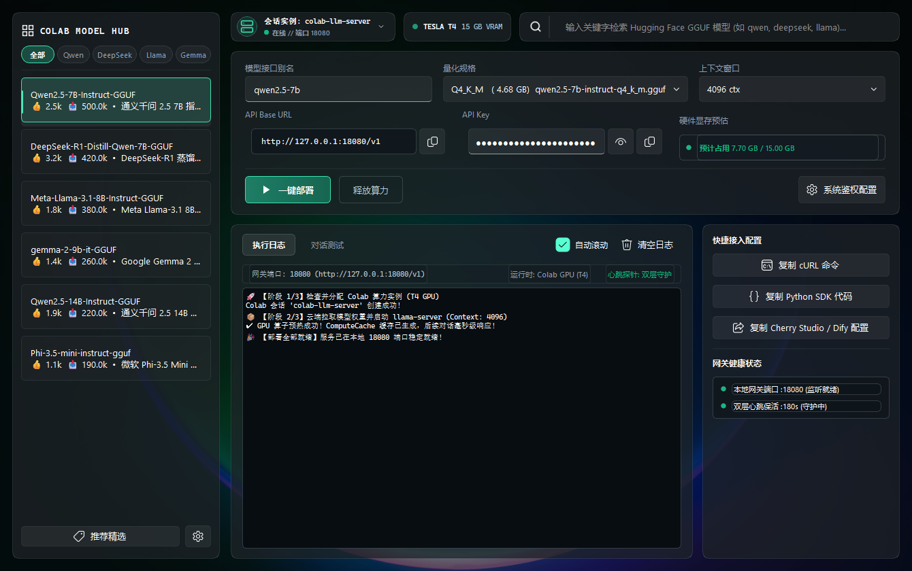

**简体中文** | [English](README_EN.md)

# Colab Model Hub & Gateway - 桌面直连大模型工作台

基于 **Google Colab GPU (T4 / L4 / A100 / H100 / G4)** 算力与官方 **`llama-server` 原生 CUDA 推理引擎** 打造的**一体化大模型桌面客户端 (PySide6)** 与 **OpenAI 兼容本地网关**。

通过内置的 `google-colab-cli` 加密 WebSocket-SSH 隧道，实现本地计算机与云端 GPU 的**点对点直连**：**0 第三方中转服务器、0 公网 IP 暴露、0 凭证硬编码、0 容器转发损耗**。



---

## 🌟 核心功能

1. **开箱即用与内置 Google OAuth2 图形化引导**：
   - `.exe` 安装包已内置 `google-colab-cli`，无需额外配置本地 Python / `uv` 环境；
   - 启动自动检测 OpenSSH 与授权状态，支持界面内一键弹出 Google 登录向导与授权码绑定；
   - 自动识别云端 `[?]` 孤立算力实例冲突，一键释放并重建会话。

2. **Hugging Face GGUF 模型检索与多卡显存动态评估**：
   - 内置精选列表与 Hugging Face GGUF 实时搜索、品牌胶囊筛选（Qwen / DeepSeek / Llama / Gemma）；
   - 自动过滤 `mmproj` 辅助权重并识别单文件与多片分片模型，按 `Q4_K_M` 优先排序；
   - 支持 **T4 (15 GB) / L4 (22.5 GB) / A100 (40 GB) / H100 (80 GB) / G4 (96 GB) / CPU** 硬件切换（含 Pro/Pro+ 高内存 `--high-mem`）与 2K~32K 上下文 KV Cache 动态显存预估。

3. **官方 `llama-server` CUDA 原生推理 + 双阶段 GPU 预热**：
   - 云端自动拉取预编译 CUDA 版 `llama-server`（可在设置中自定义 Release Tag），显存全量卸载（`-ngl 999`）；
   - 部署阶段自动执行 Prefill + Decode 双阶段 CUDA PTX 预热，首轮对话即享高速流式响应。

4. **双层防休眠、全异步交互与中英双语切换**：
   - 应用层 `/health` 探测 + 远端内核活跃脉冲，防止 Colab 闲置回收；
   - 支持界面设置中实时切换 **简体中文 / English**，支持诊断日志落盘与一键导出；
   - 一键复制接入 **cURL**、**Python OpenAI SDK**、**Cherry Studio / Dify**。

---

## 📋 环境前置要求

- **操作系统**：Windows 10 / 11（64 位，支持原生暗色标题栏），或支持 PySide6 的 Python 3.10+ 桌面环境
- **OpenSSH 客户端**：本地需可用 `ssh` 与 `ssh-keygen` 命令（Windows 10/11 默认内置，若缺失可在系统“可选功能”中启用 OpenSSH Client）
- **网络与账号**：可访问 Google Colab 与 Hugging Face 的网络环境，以及有效的 Google 账号

---

## 🚀 快速启动

### 方式 A：直接运行发布版 `.exe`（推荐给普通用户）

从 GitHub Releases 下载 `ColabModelHub.exe` 双击运行，根据右上角提示点击 **【授权 Google 账号】** 完成一次登录即可一键部署。

### 方式 B：源码开发与测试模式

```bash
pip install -r requirements.txt
py -3 -m unittest discover -s tests -v
```
- 双击 [run_dev.bat](run_dev.bat)（带终端日志输出）或 [run_dev_gui.bat](run_dev_gui.bat)（纯 GUI 窗口）；
- 或执行 `py -3 app.py`，也可在 VS Code 中按 `F5` 调试。

### 方式 C：本地打包独立 `.exe`

运行 [build_exe.bat](build_exe.bat)，完成后将自动生成并同步至根目录 `ColabModelHub.exe` 与 `dist/ColabModelHub.exe`。

---

## 📁 项目结构

```text
├── app.py                     # 桌面客户端主入口 (含内置 --colab-cli 分发器)
├── i18n.py                    # 中英双语本地化词库与翻译引擎
├── config_manager.py          # 本地配置、GPU 规格、诊断日志与密钥管理
├── hf_explorer.py             # Hugging Face GGUF 检索与显存动态评估
├── colab_orchestrator.py      # Colab 实例生命周期、OAuth 流与部署脚本注入
├── tunnel_daemon.py           # OpenSSH 直连隧道与双层防休眠心跳守护
├── gui/                       # PySide6 界面组件、登录向导与图标壁纸
├── tests/                     # 单元测试与 offscreen GUI 回归套件
├── .github/workflows/         # GitHub Actions CI 自动测试与 Tag 自动发布
├── run_dev.bat / run_dev_gui.bat / build_exe.bat
├── requirements.txt
└── LICENSE                    # GPL-3.0 开源协议
```

---

## ⚠️ 免责声明与开源协议

- **使用合规**：本项目仅作为个人学习与开发测试的桌面辅助工具。请严格遵守 [Google Colab 服务条款](https://research.google.com/colaboratory/faq.html) 与算力配额规则，切勿用于违规挂机或商业滥用。
- **隐私安全**：切勿将本地生成的 `config.json`、`.env`、`~/.colab_launcher/` 及 `秘钥/` 上传至公开仓库。
- **开源协议**：本项目基于 **GNU General Public License v3.0 ([LICENSE](LICENSE))** 开源。
