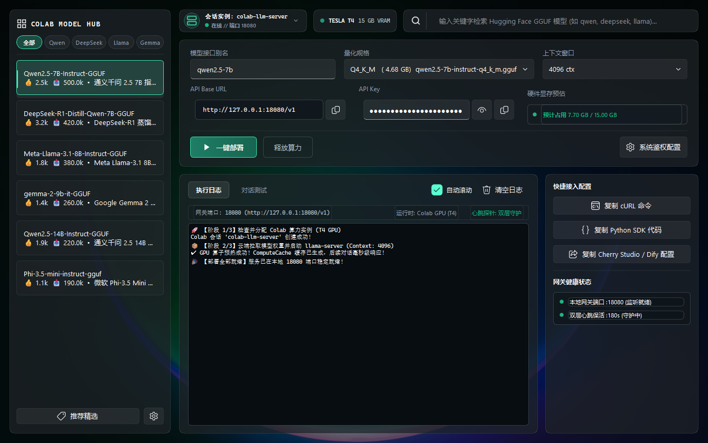

[简体中文](README.md) | **English**

# Colab Model Hub & Gateway — Desktop LLM Workbench for Google Colab

A **PySide6 desktop workstation** and **OpenAI-compatible local gateway** powered by **Google Colab GPUs (T4 / L4 / A100)** and the official native CUDA **`llama-server`** runtime.

Using an encrypted WebSocket-SSH tunnel (`google-colab-cli`), it bridges your desktop directly to a Colab GPU container with **zero relay servers, zero public IP exposure, zero hardcoded credentials, and zero wrapper overhead**.



---

## 🌟 Key Features

1. **Standalone Ready & Built-in Google OAuth2 Sign-In Wizard**:
   - Bundles `google-colab-cli` directly inside the PyInstaller `.exe` (no external Python or `uv` installation needed for end users);
   - Runs non-blocking startup pre-flight checks for `ssh` / `ssh-keygen` and Google credentials, offering an in-app OAuth2 sign-in wizard;
   - Detects orphaned `[?]` Colab assignments (`412` conflicts) and provides one-click cleanup.

2. **Hugging Face GGUF Explorer & Dynamic Multi-GPU VRAM Estimator**:
   - Featured presets, live GGUF repository search, and brand filter capsules (`Qwen` / `DeepSeek` / `Llama` / `Gemma`);
   - Filters out auxiliary `mmproj` weights, merges sharded GGUF sets, and ranks standard quants (`Q4_K_M` first);
   - Evaluates weight + KV Cache VRAM across **T4 (15 GB) / L4 (22.5 GB) / A100 (40 GB) / CPU** and 2K–32K context sizes.

3. **Native `llama-server` CUDA + Two-Phase GPU Warmup**:
   - Downloads official prebuilt CUDA `llama-server` (configurable release tag in Settings) with full GPU offload (`-ngl 999`);
   - Pre-warms both Prefill and Decode CUDA PTX kernels during deployment so your very first chat turn streams fast.

4. **Dual-Layer Keep-Alive, Bilingual UI & One-Click SDK Integration**:
   - Local `/health` probes + periodic Colab kernel activity pulse prevent idle disconnects;
   - Instant live switching between **English / 简体中文** inside Settings, plus rotating diagnostic log export;
   - One-click copy for **cURL**, **OpenAI Python SDK**, and **Cherry Studio / Dify**.

---

## 📋 Prerequisites

- **OS**: Windows 10 / 11 (64-bit, native dark title bar) or Python 3.10+ desktop environment
- **OpenSSH Client**: `ssh` and `ssh-keygen` available on `PATH` (pre-installed on most Windows 10/11 systems; otherwise enable *OpenSSH Client* in Windows Optional Features)
- **Network & Account**: Access to Google Colab and Hugging Face, plus a Google account

---

## 🚀 Quick Start

### Option A: Standalone Windows Executable (End Users)

Download `ColabModelHub.exe` from GitHub Releases, launch it, click **Sign in to Colab** if prompted, and click **Deploy**.

### Option B: Run from Source & Run Tests

```bash
pip install -r requirements.txt
python -m unittest discover -s tests -v
python app.py
```
On Windows you can also double-click [run_dev.bat](run_dev.bat) (console logs) or [run_dev_gui.bat](run_dev_gui.bat) (quiet GUI).

### Option C: Build Standalone `.exe`

Run [build_exe.bat](build_exe.bat) to produce `ColabModelHub.exe` (and `dist/ColabModelHub.exe`). No local SSH keys or config files are bundled.

---

## ⚠️ Disclaimer & License

- **Acceptable Use**: Intended strictly for personal learning, prototyping, and development testing. Please comply with the [Google Colab Terms of Service](https://research.google.com/colaboratory/faq.html) and quota limits.
- **Security**: Never commit `config.json`, `.env`, `~/.colab_launcher/`, or `秘钥/` to a public repository.
- **License**: Licensed under the **GNU General Public License v3.0 ([LICENSE](LICENSE))**.
